<!-- BBN:HEADER:START -->

<!-- BBN:HEADER:END -->

# n8n AI Agent Chat

หน้าเว็บแชทภาษาไทย “BoomBigNose - เพื่อน AI ของคุณ” ทั้งหมดอยู่ในไฟล์ index.html ข้อความจะถูกส่งไปยัง AI เอเจนต์ผ่าน n8n chat webhook ที่ตั้งไว้ในตัวแปร webhookUrl เปิด index.html ในเบราว์เซอร์ได้ทันที ถ้าจะใช้กับ workflow ของตัวเอง ให้เปลี่ยน webhookUrl เป็น URL chat webhook ของ n8n ที่คุณสร้าง

<!-- BBN:FOOTER:START -->
---

**สร้างโดย [BoomBigNose](https://github.com/Boom-Vitt)** · [Kruoop.com](https://kruoop.com) แหล่งเรียน AI + คอมมูนิตี้ · [Seeneo.ai](https://seeneo.ai) · [YouTube 220K](https://www.youtube.com/@BoomBigNose)

ถ้าโปรเจกต์นี้มีประโยชน์ กด ⭐ ให้กำลังใจกันได้เลย

<!-- BBN:FOOTER:END -->
